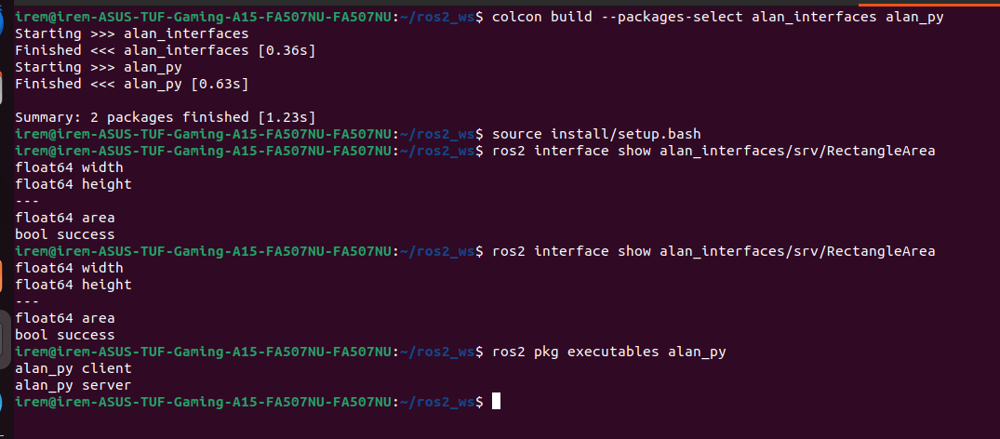
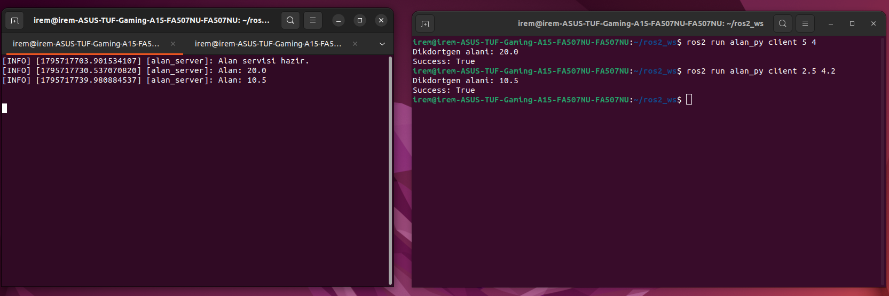
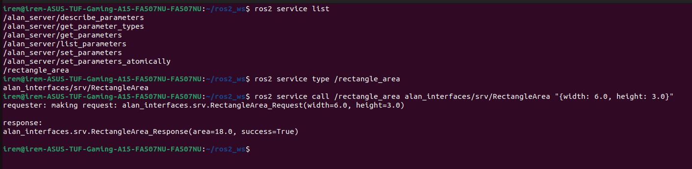
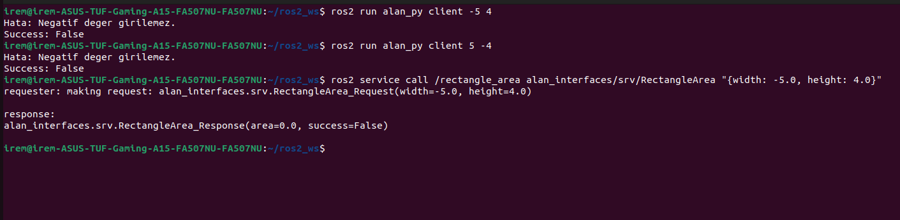

# ROS 2 - Dikdörtgen Alan Hesaplama Servisi

## 1. Projenin Amacı

Bu projede ROS 2 kullanılarak dikdörtgenin alanını hesaplayan bir servis geliştirilmiştir. İstemciden alınan genişlik ve yükseklik değerleri sunucuya gönderilerek alan hesaplaması gerçekleştirilmektedir.

## 2. Kullanılan Teknolojiler

- Ubuntu
- ROS 2
- Python
- rclpy
- ament_cmake
- ament_python

## 3. ROS 2 Paketlerinin Oluşturulması

Proje kapsamında iki ayrı ROS 2 paketi oluşturulmuştur.

- alan_interfaces: RectangleArea servis arayüzünün bulunduğu pakettir.
- alan_py: Sunucu ve istemci kodlarının bulunduğu pakettir.

Servis arayüzünde genişlik, yükseklik ve alan değerleri float64 olarak tanımlanmıştır. Bonus kapsamında bool türünde success alanı eklenmiştir.

## 4. Sunucu ve İstemcinin Çalışma Mantığı

Sunucu (server.py), istemciden gelen genişlik ve yükseklik değerlerini çarparak dikdörtgenin alanını hesaplamaktadır.

İstemci (client.py), komut satırından alınan iki sayıyı sunucuya göndermekte ve hesaplanan alanı terminalde görüntülemektedir.

## 5. Paketlerin Derlenmesi

```bash
cd ~/ros2_ws
colcon build --packages-select alan_interfaces alan_py
source install/setup.bash
```



**Şekil 1.** Oluşturulan iki ROS 2 paketi başarıyla derlenmiştir. Servis arayüzü ve çalıştırılabilir dosyalar kontrol edilmiştir.

## 6. Sunucu ve İstemcinin Çalıştırılması

Birinci terminalde sunucu çalıştırılmıştır.

```bash
source ~/ros2_ws/install/setup.bash
ros2 run alan_py server
```

İkinci terminalde istemci çalıştırılmıştır.

```bash
source ~/ros2_ws/install/setup.bash
ros2 run alan_py client 5 4
```



**Şekil 2.** Sunucu ve istemci ayrı terminallerde çalıştırılmıştır. Tam sayı ve ondalıklı değerlerle yapılan alan hesaplamalarında doğru sonuçlar elde edilmiştir.

## 7. Servisin Doğrulanması

Servisin çalışması ros2 service call komutu ile doğrulanmıştır. Kullanılan komutlar ve elde edilen çıktılar aşağıdaki ekran görüntüsünde gösterilmiştir.



**Şekil 3.** Servisin aktif olduğu ve servis tipinin doğru tanımlandığı kontrol edilmiştir. Doğrudan servis çağrısı başarıyla gerçekleştirilmiştir.

## 8. Negatif Değer Kontrolü (Bonus)

Bonus kapsamında negatif genişlik ve yükseklik değerlerinin kabul edilmemesi sağlanmıştır. İşlemin başarı durumu success alanı üzerinden kontrol edilmiştir.



**Şekil 4.** Negatif değerler hem istemci hem de doğrudan servis çağrısı üzerinden test edilmiştir. Geçersiz değerlerin reddedildiği görülmektedir.

## 9. Sonuç

ROS 2 kullanılarak dikdörtgen alan hesaplama servisi başarıyla geliştirilmiştir. Sunucu ve istemci arasındaki iletişim, servis çağrıları ve negatif değer kontrolü yapılan testlerle doğrulanmıştır.